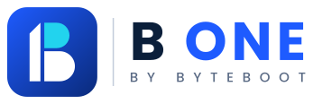

# B ONE by Byteboot - Logo Package & Brand Guidelines

**Tagline:** One platform. Complete business control.
**Modules line:** CRM · Accounting · HR · Projects · Collaboration

## 1. The logo
The symbol is a **modular B**. The vertical stem with its slanted top is a **"1"**, and the two stacked
blocks beside it are the platform's **modules** (CRM, Accounting, HR, Projects, Collaboration) working together.
One stem, many modules: **B ONE**. The cyan top block is the signature accent. Wordmark: **B ONE** in Poppins Bold, with **BY BYTEBOOT** below,
letter-spaced to the same width. All text is outlined to paths, so no font is needed to display the logo.

## 2. Which file to use
| Use case | File |
|---|---|
| Website header (light) | `svg/b-one-horizontal-color.svg` |
| Website header (dark) | `svg/b-one-horizontal-reversed.svg` |
| Hero / landing section | `svg/b-one-horizontal-tagline-*.svg` |
| Social profile, app icon | `icons/` or `social/profile-avatar-*.png` |
| Favicon / PWA | `favicon/` (see `web/head-snippet.html`) |
| Letterhead, invoices, print | `svg/b-one-horizontal-color.svg` (or `-mono-dark` for B/W) |
| Merchandise, stamps, single colour | `svg/*-mono-dark.svg` / `*-mono-white.svg` |
| Square / stacked spaces | `svg/b-one-vertical-*.svg` |
| Email signature | `social/email-signature-300w.png` (+ `@2x`) |
| Link previews | `social/og-image-1200x630.png` |
| Slides | `social/presentation-background-1920x1080.png` |

Versions: `color` (light backgrounds), `reversed` (dark backgrounds), `mono-dark`, `mono-white`.
PNGs are transparent, `@1x` = 800 px wide, `@2x` = 1600 px wide. White versions look invisible on a light viewer; they are meant for dark backgrounds.

## 3. Colours
| Name | Hex | Use |
|---|---|---|
| Navy | `#0B1F3A` | Text, dark backgrounds |
| Brand Blue | `#1E5BFF` | Primary, "ONE", buttons |
| Deep Blue | `#0A2A7A` | Gradient end, hover |
| Cyan | `#22D3EE` | Accent (the flag), highlights |
| Slate | `#5B6B85` | Secondary text |
| Mist | `#D5DCE8` | Borders, dividers |
Brand gradient: `#2F6BFF` to `#0A2A7A` at 135 degrees. CSS variables are in `web/brand-tokens.css`.

## 4. Typography
Poppins: Bold for headings, Medium for sub-headings, Regular for body (free on Google Fonts).
Fallback: system-ui, Segoe UI, Roboto, sans-serif.

## 5. Clear space & minimum size
- Clear space on all sides = **25% of the logo height** (for the horizontal logo, about the height of the letter "B" in the wordmark).
- Minimum width: horizontal logo **120 px** (digital) / **30 mm** (print); icon **16 px**; stacked logo **80 px**.
- Below 120 px wide use the icon or symbol only. The tagline versions need at least **320 px** width to stay readable.

## 6. Do / Don't
Do: use supplied files, keep proportions, use `reversed` on dark backgrounds, keep good contrast.
Don't: stretch or rotate, recolour outside the palette, add shadows/glows/outlines, place on busy photos
without a solid panel, retype the wordmark in another font, or rearrange the lockup.

## 7. Web quick start
```html
<picture>
  <source srcset="svg/b-one-horizontal-reversed.svg" media="(prefers-color-scheme: dark)">
  
</picture>
```
Favicons: copy `favicon/*` to the site root and paste `web/head-snippet.html` into `<head>`.
Replace `YOUR-DOMAIN` in the Open Graph tags with the real domain.

## 8. Package contents
```
svg/        26 vector logos (7 layouts x 4 colour versions)
png/        transparent PNGs of every SVG (@1x 800w, @2x 1600w)
icons/      square app icons 16 to 1024 px
favicon/    favicon.ico/.svg, 16/32/48, apple-touch, android 192/512, maskable, site.webmanifest
social/     OG image, Twitter/LinkedIn banners, avatars, slides background, email signature
web/        index.html demo, head-snippet.html, brand-tokens.css
preview.png overview sheet
```
Note: the SVGs use plain shapes and outlined text, so they open correctly in Illustrator, Figma, Inkscape, Canva and browsers.
